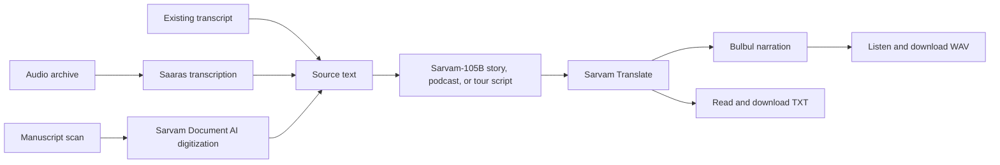

# Aaroh — Heritage Storytelling Agent

**Bring heritage into the present.** Aaroh turns oral archives and historic manuscripts into interactive stories, podcast scripts, or guided tours, then translates and narrates them in an Indian language.

> This project implements **idea #26, “Heritage Storytelling Agent,”** from the supplied idea library.

## Contents

- [The idea](#the-idea)
- [Why build it](#why-build-it)
- [What Aaroh does](#what-aaroh-does)
- [How it works](#how-it-works)
- [Requirements](#requirements)
- [Run locally](#run-locally)
- [Run with Docker](#run-with-docker)
- [Use the app](#use-the-app)
- [Languages and limits](#languages-and-limits)
- [Configuration and secrets](#configuration-and-secrets)
- [Data handling and rights](#data-handling-and-rights)
- [Project structure](#project-structure)
- [Troubleshooting](#troubleshooting)
- [Current status and next steps](#current-status-and-next-steps)
- [Official documentation](#official-documentation)

## The idea

The idea library describes the Heritage Storytelling Agent as a tool that:

1. Transcribes and translates historic manuscripts and oral archives.
2. Transforms historical content into interactive stories, podcasts, or guided tours.
3. Brings history to life with natural multilingual voice narration.

Aaroh follows those three parts. It is focused on heritage material and its retelling; it is not a general-purpose dubbing tool or tutor. The pasted transcript option is a convenient way to work with archives that have already been digitized or transcribed.

## Why build it

Historical and community knowledge can be difficult to access when it is stored in recordings, scans, or a language a visitor does not speak. Aaroh provides one path from source material to an accessible spoken experience while keeping the original text visible beside the adaptation.

The product hypothesis is that museums, libraries, heritage organizations, tourism teams, and educators may value a way to create multilingual stories and tour narration from existing collections. That demand and a sustainable pricing model still need validation with real archive owners and audiences.

The supplied AudioRefine code is a useful starting point for its media-processing workflow. Aaroh keeps that code in the repository, but implements the Heritage Storytelling idea as its own workflow. The earlier suggestions in the pasted notes included ideas #30 and a hybrid dubbing product; those were not selected because the request was to build an idea from the library without combining ideas.

## What Aaroh does

- **Accepts archive material:** audio recording, scanned manuscript (PDF/image/ZIP), or pasted transcript.
- **Transcribes oral history:** uses Saaras and supports a selected language or automatic detection.
- **Reads manuscript scans:** uses Sarvam Document AI to digitize the document.
- **Creates a new form:** uses Sarvam-105B to shape source content into an interactive story, narrator-led podcast script, or guided tour.
- **Translates the script:** uses Sarvam Translate for the selected narration language.
- **Generates narration:** uses Bulbul to create a WAV audio track.
- **Shows the source and output together:** the transcript, adapted script, translated story, and generated audio remain available in the current browser session.
- **Downloads deliverables:** download the translated script as TXT and narration as WAV.

The story-generation prompt asks the model to stay grounded in the supplied archive and avoid inventing dates, names, events, or quotations. Review generated history before publishing it: AI transcription, translation, and retelling can still make mistakes.

## How it works



The Streamlit interface is in `app.py`. API calls and media processing live in `heritage_storytelling.py`. Audio is converted to mono 16 kHz WAV and sent to Saaras in 25-second chunks, within the synchronous transcription endpoint’s 30-second limit. Manuscript digitization uses Sarvam Document AI’s asynchronous job flow. Text-to-speech requests are split into chunks within Bulbul’s documented request limit and joined into one WAV file.

## Requirements

- Python 3.10 or newer (the included Docker image uses Python 3.12).
- FFmpeg, used by `pydub` to read and convert common audio formats.
- A Sarvam API key with access/credits for the APIs used by the workflow.
- Internet access from the machine running the app.

On macOS, install FFmpeg with Homebrew:

```bash
brew install ffmpeg
```

On Ubuntu or Debian:

```bash
sudo apt-get update
sudo apt-get install ffmpeg
```

## Run locally

From the repository root:

```bash
python3 -m venv .venv
source .venv/bin/activate
python -m pip install --upgrade pip
python -m pip install -r requirements.txt
```

Set the API key in a local `.env` file. On a first setup only, copy the blank template and edit the new file:

```bash
cp .env.example .env
```

Edit `.env` so it contains your key:

```dotenv
SARVAM_API_KEY=your-sarvam-api-key
```

Alternatively, export the variable in your shell instead of using `.env`:

```bash
export SARVAM_API_KEY="your-sarvam-api-key"
```

Start the app bound to your machine only:

```bash
streamlit run app.py --server.address 127.0.0.1
```

Open [http://127.0.0.1:8501](http://127.0.0.1:8501). To stop the server, press `Ctrl+C` in the terminal.

> If you already have a `.env` file, keep it; do not run `cp .env.example .env` over it. `.env` is ignored by Git. The checked-in `.env.example` must contain placeholders only.

## Run with Docker

Build the image:

```bash
docker build -t aaroh .
```

Run it with the local `.env` file and publish the port only on localhost:

```bash
docker run --rm --env-file .env -p 127.0.0.1:8501:8501 aaroh
```

Then open [http://127.0.0.1:8501](http://127.0.0.1:8501). The image installs FFmpeg, runs as a non-root user, and includes a Streamlit health check. The key is supplied at container runtime; it is not copied into the image. Do not expose this prototype to a public network without adding appropriate authentication and deployment controls.

## Use the app

1. Choose **Oral archive**, **Manuscript scan**, or **Existing transcript**.
2. Upload the file or paste the transcript. Set the source language when asked; audio can use automatic detection.
3. Choose **Interactive story**, **Podcast episode**, or **Guided tour**.
4. Choose the intended audience, narration language, and Bulbul narrator voice.
5. Select **Create the heritage experience** and wait for transcription/digitization, script creation, translation, and narration to finish.
6. Read the adapted script, inspect the source text, play the audio, and download the TXT or WAV output.

The interactive-story option creates a script with reader choices or reflection prompts; the current app does not implement a branching story engine. Podcast output is a single narrator script and single-voice narration; it does not add interviews, music, or sound design. Guided tours are generated from source material and do not include maps or location tracking.

## Languages and limits

The language choices below reflect the current app configuration. API availability and account limits can change; confirm against the official docs linked below.

| Capability | Current choices / limits |
| --- | --- |
| Oral archive input | WAV, MP3, M4A, MP4, AAC, FLAC, OGG, WebM; processed in 25-second chunks |
| Manuscript input | PDF, PNG, JPG/JPEG, ZIP of images; Document AI allows up to 10 pages per PDF/ZIP job and 200 MB per file |
| Transcript input | Paste source text directly; story generation currently accepts up to about 60,000 characters |
| Source language options | Assamese, Bengali, English, Gujarati, Hindi, Kannada, Kashmiri, Konkani, Malayalam, Manipuri, Marathi, Nepali, Odia, Punjabi, Sanskrit, Sindhi, Tamil, Telugu, Urdu |
| Narration languages | Bengali, English, Gujarati, Hindi, Kannada, Malayalam, Marathi, Odia, Punjabi, Tamil, Telugu |
| Translation request size | The app splits translated text into chunks of up to 1,800 characters |
| Narration request size | Bulbul requests are split into chunks of up to 2,300 characters; output is joined into a WAV |

The synchronous Saaras REST API accepts up to 30 seconds per request; the app uses shorter 25-second chunks. For very long recordings, chunk boundaries can interrupt a sentence. Large documents and long scripts can take time and incur API usage charges. Check your Sarvam plan and current pricing before processing large archives.

## Configuration and secrets

| Setting | Purpose |
| --- | --- |
| `SARVAM_API_KEY` | Required API subscription key; loaded from the process environment or local `.env` file |

Never put a real key in source code, README examples, screenshots, or commits. `.env`, `.venv/`, generated audio, and Streamlit secrets are ignored by Git. The `.env.example` file is a blank template and is safe to share.

## Data handling and rights

- Uploaded audio is temporarily written to a local temporary file for conversion and transcription; Aaroh deletes that temporary file after processing.
- Manuscript scans and transcripts are kept in the active Streamlit session, not saved to the repository by Aaroh.
- Source material is sent to Sarvam APIs to perform transcription, document digitization, story generation, translation, or narration. Read the provider’s current data-retention terms and your workspace settings before submitting sensitive or restricted material.
- Do not upload material unless you have permission to process it and create derivative works. Digitizing or translating an archive does not itself grant publication rights.
- The local prototype does not have user accounts, a persistent archive database, a role system, or public-deployment authentication. Keep it on a trusted machine/network until those controls are added.

## Project structure

```text
.
├── app.py                    # Streamlit interface and workflow orchestration
├── heritage_storytelling.py  # Sarvam calls, transcription, digitization, and audio handling
├── requirements.txt          # Python dependencies
├── Dockerfile                # Container build and health check
├── .dockerignore             # Files excluded from container build context
├── .gitignore                # Ignores local secrets, virtualenv, and generated media
├── .env.example              # Blank environment-variable template
├── README.md                 # This guide
└── AudioRefine-main 2/       # User-provided AudioRefine source, retained as supplied
```

The `AudioRefine-main 2/` folder is preserved as reference material. Aaroh does not import that folder at runtime; the new app uses the Sarvam workflow described above.

## Troubleshooting

### “Add your Sarvam key” appears

Check that `.env` is at the repository root and contains `SARVAM_API_KEY=...`, or export the variable in the same shell that launches Streamlit. Restart the app after changing the key. Do not put the real key in `.env.example`.

### Audio transcription fails or returns no text

- Confirm FFmpeg is installed and available on `PATH` (`ffmpeg -version`).
- Try a supported audio format and a clear recording with less background noise.
- Choose the recording language instead of automatic detection when you know it.
- Very short chunks at a sentence boundary may be difficult to transcribe; try a different recording or trim long silence at the start/end.

### Manuscript digitization fails

- Use a readable PDF, PNG, or JPG/JPEG scan, or a ZIP of page images.
- Keep PDFs and ZIPs within the documented 10-page limit and files below 200 MB.
- Select the manuscript’s language accurately and use a clear, straight scan.
- Confirm that your Sarvam account has Document AI access and available credits.

### Translation or narration fails

- Confirm that the selected narration language is one of the 11 options in the app.
- Check the API key’s access, rate limits, and credits.
- If the generated script is very long, use a shorter archive excerpt.
- Try again after a temporary network or rate-limit error.

### Docker cannot start

- Confirm Docker is installed and running.
- Check that port 8501 is not already in use.
- Confirm `.env` exists and contains the key; `--env-file .env` reads the file at container start.

## Current status and next steps

The application flow and Sarvam client wiring are implemented. Python dependencies were installed in the local ignored `.venv`; syntax/import checks passed, and a minimal Sarvam chat request confirmed that the local key authenticates. A real archive-to-audio run still depends on the archive file and the API entitlements/credits available to the account.

Useful next product steps would be to test with archive owners and intended listeners, add review/approval before publishing generated content, and add authentication, persistent job tracking, and operational monitoring before any public deployment. These are future hardening steps, not current app features.

This repository does not currently include an explicit open-source license. Add one before redistributing the code if you want to grant reuse rights.

## Official documentation

- [Sarvam API authentication](https://docs.sarvam.ai/api-reference/authentication)
- [Sarvam Python and JavaScript SDKs](https://docs.sarvam.ai/api/getting-started/sdks)
- [Saaras speech-to-text REST API](https://docs.sarvam.ai/api-reference/speech-to-text/transcribe)
- [Sarvam Document Intelligence overview](https://docs.sarvam.ai/api/api-guides-tutorials/document-intelligence/overview)
- [Sarvam Chat Completion V1](https://docs.sarvam.ai/api-reference/chat/chat-completions-v1)
- [Sarvam Text Translation](https://docs.sarvam.ai/api-reference/text/translate-text)
- [Bulbul text-to-speech REST API](https://docs.sarvam.ai/api-reference/text-to-speech/convert)
